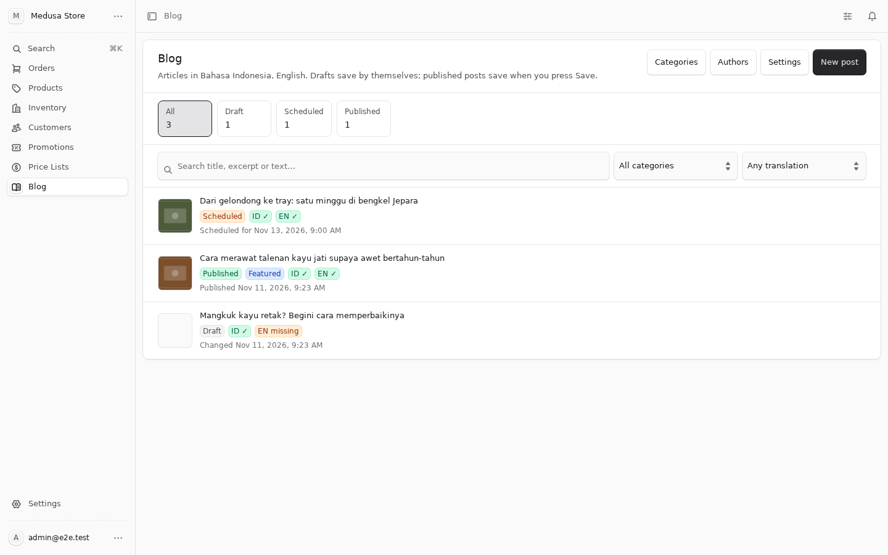
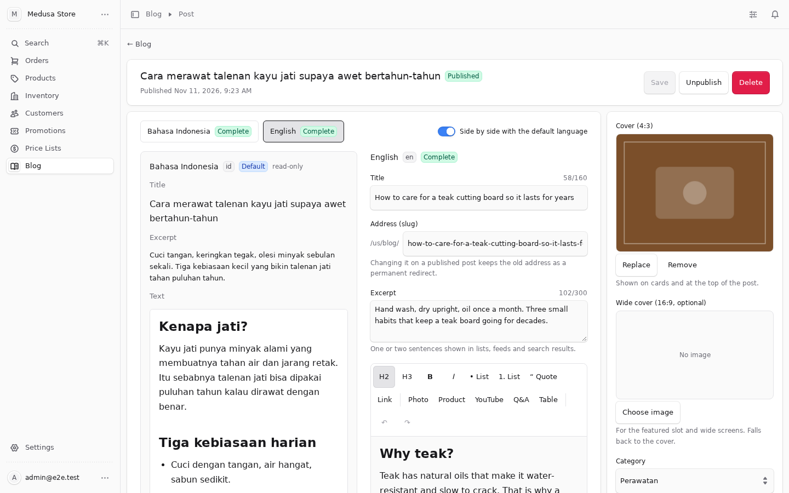
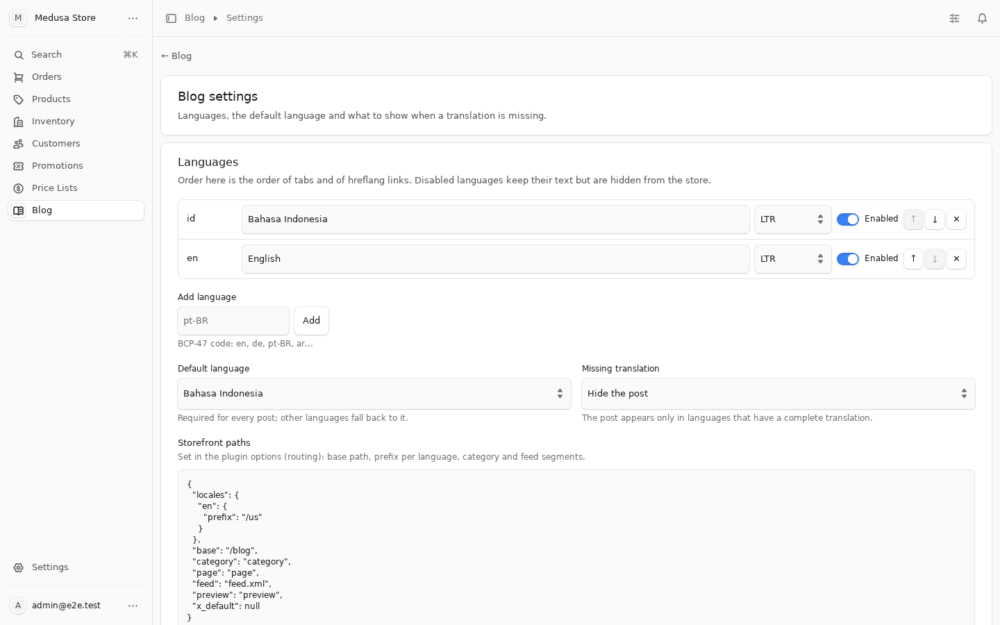

<p align="center">
  <a href="https://hauskayu.com">
    <picture>
      <source media="(prefers-color-scheme: dark)" srcset="docs/logo-dark.svg">
      
    </picture>
  </a>
</p>

# medusa-blog-seo

**A multilingual blog for Medusa v2 with SEO built in.** Posts, categories and authors in any number of
languages (configured, not hard-coded), per-language slugs with permanent redirects when they change, fallback
rules, scheduled publishing, preview links, a rich editor with shoppable product cards, and helpers for JSON-LD,
hreflang, sitemaps and RSS.
<br>Blog multibahasa untuk Medusa v2 dengan SEO bawaan: tulisan, kategori, dan penulis dalam bahasa apa pun
(diatur, bukan hard-code), slug per bahasa dengan redirect permanen, aturan fallback, publikasi terjadwal,
tautan pratinjau, editor kaya dengan kartu produk, dan helper JSON-LD, hreflang, sitemap, RSS.

[](https://www.npmjs.com/package/medusa-blog-seo)
[](https://github.com/haustex/cm-medusa-blog-seo/actions/workflows/ci.yml)
[](https://medusajs.com)
[](LICENSE)

### Compatibility

| Plugin | Medusa | Node | Tested in CI on |
| --- | --- | --- | --- |
| 0.1.x | 2.19.0 or newer 2.x (`^2.19.0`) | 20.19+ or 22.12+ | Medusa 2.19.0 and 2.22.2 |

Images go through the File Module (local, S3, R2, …). `sharp` is optional: when it is installed, uploads are
turned upright, resized and stripped of EXIF data.

### Quick start

```bash
npm install medusa-blog-seo
```

```ts
// medusa-config.ts
plugins: [
  {
    resolve: "medusa-blog-seo",
    options: {
      storefront_url: "https://your-store.com",
    },
  },
],
```

```bash
npx medusa db:migrate
```

Open **Blog** in the Admin sidebar. Add your languages under **Settings** (the default is one locale, `en`),
write a post, publish it. The storefront reads `/store/blog-seo/posts` and `/store/blog-seo/posts/{slug}` with
`?locale=`.
Full steps: [Installation](#installation) · [Languages](#languages-and-fallback) · [Options](#plugin-options) ·
[Storefront (Next.js)](#storefront-nextjs) · [Store API](#store-api) · [Limits](#limits).

[English](#english) · [Bahasa Indonesia](#bahasa-indonesia)

| Posts | Editor, side by side with the default language |
| --- | --- |
|  |  |

| Languages |
| --- |
|  |

---

## English

### Features

**Content**

- **Posts** with per-language title, slug, excerpt, body, meta title/description, sharing (OG) image, cover alt
  text and tags; shared cover (4:3) and wide cover (16:9), category, author, related products, one featured post.
- **Categories** with name, slug and description per language; **authors** (person or organisation) with photo,
  website, profile links (`sameAs`), and job title and bio per language.
- **Rich editor** in the Admin (Tiptap): headings, lists, quotes, links, tables, photos with alt and caption,
  YouTube embeds, **product cards** picked from the catalogue, and Q&A blocks. Bodies are sanitised server-side
  and rendered into blocks, a table of contents (from H2/H3) and FAQ items (an H3 ending in "?" and its paragraphs).
- **Draft → scheduled → published.** A job (every 5 minutes, `BLOG_SEO_PUBLISH_CRON` to change it) publishes due
  posts. Drafts autosave in the Admin; published posts save on demand. The first public date is kept when a post is
  republished; `content_updated_at` moves on every public change.
- **Preview links** per language with a secret token (renewable), showing drafts and incomplete translations.

**Languages**

- **Not hard-coded.** The list of locales (BCP 47: `en`, `id`, `pt-BR`, `ar`…), their names, text direction, order,
  the default locale and the fallback rule are set in **Admin → Blog → Settings**, or fixed in the plugin options
  (then the Admin shows them read-only).
- **Fallback** per store: `default` (show the default language at that locale's address), `label` (same, and the
  storefront can say "not yet translated"), or `hide` (the post exists only in languages with a complete translation).
- **Completeness** per language in the Admin (tabs, badges, a "missing in …" filter, side-by-side editing with the
  default language). A post can be published once its default-language translation is complete (and a cover, if
  `publish.require_cover`); other languages become visible as they are completed.
- **Slug history.** When a slug changes (edited by hand, or a locale that used to show the fallback gets its own
  translation), the old address is kept in `bseo_post_slug_history` and the Store API answers
  `{ post: null, redirect: "<new slug>", status: 301 }` for it. History always points at the post, never at another
  slug, so there are no chains or loops; a live slug always wins over a historical one.
- `hreflang` and `x-default` maps, sitemap entries with alternates, an RSS feed per language, `<html lang dir>`
  values, and per-locale routing (path prefix or a separate origin per language).

**Integration**

- **Store API** `/store/blog-seo/*`, **Admin API** `/admin/blog-seo/*`, a typed client (`medusa-blog-seo/sdk`),
  SEO helpers (`medusa-blog-seo/seo`), JSON-LD helpers (`medusa-blog-seo/jsonld`).
- **Events** `blog_seo.post.published|updated|unpublished|deleted`, `blog_seo.category.changed`,
  `blog_seo.author.changed`, `blog_seo.settings.changed`, with slugs (and previous slugs) per locale.
- **Revalidate webhook** (optional): public changes are batched and POSTed to your storefront with a secret
  header, so it can revalidate or purge exactly the pages that changed.
- Products are linked through a module link (`product.bseo_posts` in Query), so a product page can list the posts
  that feature it.
- Admin texts in English and Indonesian (follows the Admin user's language).

### Requirements

- Medusa 2.19.0 or newer 2.x, PostgreSQL. Redis recommended (events, workflows).
- The File Module for uploads (the default local provider works; S3/R2 for production). `sharp` optional.

### Installation

1. `npm install medusa-blog-seo` (and `npm install sharp` if you want uploads processed).
2. Add the plugin to `medusa-config.ts` (see [Quick start](#quick-start)). `storefront_url` makes the Admin's
   "preview" and "public page" links absolute.
3. `npx medusa db:migrate` creates the tables `bseo_settings`, `bseo_author`, `bseo_author_translation`,
   `bseo_category`, `bseo_category_translation`, `bseo_post`, `bseo_post_translation`, `bseo_post_slug_history`
   and the post–product link table.
4. Restart. The job `blog-seo-publish-scheduled` runs on the worker.
5. In the Admin, open **Blog → Settings** and set your languages (unless you fixed them in the options).

### Languages and fallback

Every post has a translation row per language. The **default locale** is required for publishing; the others are
optional and become visible as they are completed (title, excerpt, body). What a reader sees at a language that has
no complete translation depends on `fallback`:

| `fallback` | Post list and post page in that language | `translated` in the API |
| --- | --- | --- |
| `default` | The default-language text at that language's address | `false` |
| `label` | Same; the storefront can show a "not yet translated" note | `false` |
| `hide` | The post is not listed and its address answers 404 | – |

A locale that shows the fallback uses the default locale's slug. When its own translation is completed, the slug
changes to the translated one and the previous address is kept as a permanent redirect (see
[Slug history](#features)).

Locales can be given per store in the Admin, or fixed in the options:

```ts
options: {
  locales: [{ code: "id", name: "Bahasa Indonesia" }, { code: "en" }, { code: "ar", dir: "rtl" }],
  default_locale: "id",
  fallback: "hide",
}
```

Names default to the language's own name (`Deutsch`, `日本語`), direction to `rtl` for Arabic, Hebrew, Persian and
Urdu. Disabling a language in the Admin hides it from the store but keeps its text.

The locale of a Store request is taken from `?locale=`, then the `x-medusa-locale` header, then Medusa's own
`req.locale`, else the default. An exact match wins, then the same language (`en-GB` → `en`), else the default.

### Plugin options

```ts
{
  resolve: "medusa-blog-seo",
  options: {
    locales: [{ code: "id" }, { code: "en" }],   // optional; given here they are locked in the Admin
    default_locale: "id",                           // optional
    fallback: "default",                            // "default" | "label" | "hide"
    storefront_url: "https://your-store.com",       // absolute preview / public links in the Admin
    routing: {
      locales: { en: { prefix: "/us" } },           // per locale: { prefix } or { origin: "https://example.de" }
      base: "/blog",                                // blog root
      category: "category",                         // /blog/category/{slug}
      page: "page",                                 // /blog/page/2
      feed: "feed.xml",                             // /blog/feed.xml
      preview: "preview",                           // /blog/preview/{token}
      x_default: "en",                              // locale carrying hreflang="x-default" (default: default locale)
    },
    content: {
      image_origins: ["https://cdn.your-store.com"], // extra origins allowed in ; upload URLs are learned
      site_hosts: ["your-store.com"],               // links to these hosts are internal (no target=_blank)
      faq_from_headings: true,                      // H3 ending in "?" + paragraphs → FAQ
      words_per_minute: 200,                        // reading time
      max_body_bytes: 2 * 1024 * 1024,
      reserved_slugs: ["search"],                   // besides the routing segments
    },
    publish: { require_excerpt: true, require_cover: false },
    uploads: { process_images: true, max_bytes: 25 * 1024 * 1024, max_side: 2400, jpeg_quality: 88 },
    revalidate: { url: "https://your-store.com/api/revalidate", secret: process.env.REVALIDATE_SECRET, delay_ms: 2000 },
    showCredit: false,                              // small "by Haus Kayu" line under the Admin pages
  },
}
```

Non-default locales get the path prefix `/{code}` unless `routing.locales[code].prefix` says otherwise (`""` for
no prefix, or `origin` for a separate domain). `BLOG_SEO_PUBLISH_CRON` (env) changes the publish job's schedule.

### Storefront (Next.js)

The typed client works with `@medusajs/js-sdk` or any object with `client.fetch`.

```ts
// lib/blog.ts
import Medusa from "@medusajs/js-sdk"
import { blogSeoStore } from "medusa-blog-seo/sdk"
import { blogUrls, hreflang, htmlAttributes, postRedirectUrl, sitemapEntries, rssFeed } from "medusa-blog-seo/seo"
import { postJsonLd } from "medusa-blog-seo/jsonld"

const sdk = new Medusa({ baseUrl: process.env.MEDUSA_BACKEND_URL!, publishableKey: process.env.MEDUSA_PUBLISHABLE_KEY! })
export const blog = blogSeoStore(sdk)
export const urls = async () => blogUrls((await blog.settings()).settings, process.env.SITE_URL)
```

```tsx
// app/[locale]/blog/[slug]/page.tsx
import { notFound, permanentRedirect } from "next/navigation"

export default async function Post({ params }: { params: Promise<{ locale: string; slug: string }> }) {
  const { locale, slug } = await params
  const u = await urls()
  const r = await blog.getPost(slug, locale)          // 404 → throws; old slug → { redirect }
  const to = postRedirectUrl(u, locale, r)
  if (to) permanentRedirect(to)                       // old address → 301 to the new slug
  if (!r.post) notFound()
  const jsonLd = postJsonLd(u, locale, r.post, { organization: { name: "Your store", url: process.env.SITE_URL! } })
  return (
    <article dir={r.post.dir}>
      <script type="application/ld+json" dangerouslySetInnerHTML={{ __html: JSON.stringify(jsonLd) }} />
      <h1>{r.post.title}</h1>
      <div dangerouslySetInnerHTML={{ __html: r.post.body_html }} />
    </article>
  )
}

export async function generateMetadata({ params }) {
  const { locale, slug } = await params
  const u = await urls()
  const r = await blog.getPost(slug, locale)
  if (!r.post) return {}
  return {
    title: r.post.seo_title,
    description: r.post.seo_description,
    alternates: { canonical: u.post(locale, r.post.slug), languages: hreflang(u, r.post.alternates) },
    openGraph: { images: r.post.og_image ? [r.post.og_image] : [] },
  }
}
```

`r.post.blocks` is the body as typed blocks (paragraphs, headings, images, product cards with `product_id`,
YouTube ids, tables, Q&A), for storefronts that render their own components instead of `body_html`.

```ts
// app/sitemap.ts
export default async function sitemap() {
  const [u, { posts }] = await Promise.all([urls(), blog.index()])
  return sitemapEntries(u, posts, { images: true })   // one entry per post and locale, with hreflang alternates
}

// app/[locale]/blog/feed.xml/route.ts
export async function GET(_: Request, { params }) {
  const { locale } = await params
  const [u, { posts }] = await Promise.all([urls(), blog.index()])
  return new Response(rssFeed(u, locale, posts, { title: "Your store blog", description: "…" }), { headers: { "content-type": "application/rss+xml" } })
}
```

`htmlAttributes(settings, locale)` gives `{ lang, dir }` for `<html>`. `blog.listPosts({ locale, category, author,
tag, limit, offset })` answers the list page (the featured post is returned separately so pages never repeat it;
`featured: "none"` turns that off). `blog.preview(token, locale)` renders a preview page; use `cache: "no-store"`.

**Revalidation.** With `revalidate.url` set, the backend POSTs (batched, `x-revalidate-secret` header):

```json
{ "blog_seo": { "posts": [{ "id": "…", "slugs": { "id": "a", "en": "b" }, "previous_slugs": { "en": "old" }, "category_slugs": {}, "previous_category_slugs": {} }], "categories": ["…"], "all": false } }
```

Revalidate the post pages for `slugs` and `previous_slugs`, the category pages, and the index when `all` is true.

### Store API

Requires a publishable API key. Locale from `?locale=` / `x-medusa-locale`.

| Method | Path | Answer |
| --- | --- | --- |
| GET | `/store/blog-seo/settings` | `{ settings }`: enabled locales (code, name, dir), default, fallback, routing, x_default |
| GET | `/store/blog-seo/posts?locale=&category=&author=&tag=&featured=separate\|none&limit=12&offset=0` | `{ posts, featured, category, count, limit, offset, locale }` |
| GET | `/store/blog-seo/posts?view=index` | `{ posts }`: every public post with slug/title/excerpt per readable locale (sitemap, feeds, llms.txt) |
| GET | `/store/blog-seo/posts/{slug}?locale=` | `{ post, more }`, or `{ post: null, redirect, status: 301, locale }` for a previous slug, or 404 |
| GET | `/store/blog-seo/categories?locale=` | `{ categories, locale }` with `post_count` and `alternates` |
| GET | `/store/blog-seo/authors?locale=`, `/store/blog-seo/authors/{slug}` | authors with job title and bio in the locale |
| GET | `/store/blog-seo/preview/{token}?locale=` | `{ post, more }` for any status, incomplete translations included |

A post answers `locale`, `translated` (false when shown through the fallback), `dir`, `alternates` (slug per locale
that can be read), `body_html`, `blocks`, `toc`, `faq`, `reading_minutes`, `tags`, `product_ids`, `category`,
`author`, SEO fields. Errors are `{ type, code, message }` with HTTP 404 / 400 / 409 (`slug_taken`) / 403 (`locked`).

### Admin API

`/admin/blog-seo/settings` (GET/POST), `/config` (GET), `/posts` (GET with `status`, `category_id`, `author_id`,
`missing_locale`, `q`, `limit`, `offset`; POST), `/posts/{id}` (GET/POST/DELETE), `/posts/{id}/publish`
(POST `{ at }`: a future date schedules), `/posts/{id}/unpublish`, `/posts/{id}/preview-token`, `/categories`,
`/categories/{id}`, `/authors`, `/authors/{id}`, `/uploads` (POST JSON `{ filename, data: "data:image/…", kind }`
or multipart `files`). `blogSeoAdmin(sdk)` in `medusa-blog-seo/sdk` wraps them.

### Limits

- The index view (`?view=index`), sitemap and RSS helpers, slug lookups and category counts load **up to 5000
  public posts** into memory per request. That covers most shops' blogs; above that, paginate `listPosts` and
  build sitemaps from it instead of `index()`.
- Bodies are capped at `content.max_body_bytes` (2 MiB by default) after sanitising; images at
  `uploads.max_bytes` (25 MiB) and `max_side` (2400 px).
- Related products per post: 12. Tags per translation: 20, lower-case.
- Category and author pages, tags and search are per locale; there is no cross-locale search.

### FAQ

**Can I use it in one language?** Yes. The default settings are one locale, `en`; the Admin shows one tab.

**I write in Indonesian and translate some posts to English. What should I set?** Locales `id` (default) and
`en`, `fallback: "hide"` if untranslated posts must not appear under `/en` at all, `"default"` or `"label"` if
they should appear in Indonesian until translated. In every case the English address redirects permanently once
the translation is complete.

**Does changing a slug break links?** No. Old slugs stay as permanent redirects, per language.

**Where are images stored?** In the File Module (the one configured in your `medusa-config.ts`). The Admin shows
only images from the File Module's origin and `content.image_origins`.

**Does it conflict with another blog module?** Tables are `bseo_*`, the module key is `blogSeo`, routes are
`/blog-seo/*`, the Admin route is `/blog-seo`: it can run next to an existing blog while you migrate.

---

## Bahasa Indonesia

### Fitur

- **Tulisan** dengan judul, slug, ringkasan, isi, meta title/description, gambar berbagi (OG), teks alt sampul,
  dan tag **per bahasa**; sampul 4:3 dan 16:9, kategori, penulis, produk terkait, satu tulisan unggulan.
- **Kategori** (nama, slug, deskripsi per bahasa) dan **penulis** (orang/organisasi, foto, situs, tautan profil,
  jabatan dan bio per bahasa).
- **Editor kaya** di Admin: heading, daftar, kutipan, tautan, tabel, foto dengan alt dan keterangan, YouTube,
  **kartu produk** dari katalog, blok tanya-jawab. Isi disanitasi di server, jadi blok, daftar isi (H2/H3), dan
  FAQ (H3 berakhiran "?" + paragrafnya).
- **Draf → terjadwal → terbit** lewat job tiap 5 menit (`BLOG_SEO_PUBLISH_CRON`). Draf tersimpan otomatis;
  tulisan terbit disimpan saat menekan Simpan. Tanggal terbit pertama dipertahankan saat diterbitkan ulang.
- **Tautan pratinjau** per bahasa dengan token rahasia (bisa diperbarui).
- **Bahasa tidak di-hardcode**: daftar locale (BCP 47), nama, arah teks, urutan, bahasa utama, dan aturan
  fallback diatur di **Admin → Blog → Pengaturan** atau dikunci lewat opsi plugin.
- **Fallback** `default` (tampilkan bahasa utama di alamat bahasa itu), `label` (sama, storefront bisa memberi
  catatan "belum diterjemahkan"), atau `hide` (tulisan hanya ada di bahasa yang terjemahannya lengkap).
- **Kelengkapan per bahasa** di Admin: tab, badge, filter "belum ada …", edit berdampingan dengan bahasa utama.
  Tulisan bisa terbit begitu terjemahan bahasa utamanya lengkap; bahasa lain muncul begitu lengkap.
- **Riwayat slug**: slug yang berubah (diedit, atau bahasa yang tadinya fallback dapat terjemahan sendiri)
  disimpan di `bseo_post_slug_history`; Store API menjawab `{ post: null, redirect: "<slug baru>", status: 301 }`
  untuk slug lama. Riwayat selalu menunjuk ke tulisan, bukan slug lain: tidak ada rantai atau loop; slug yang
  masih hidup selalu menang.
- `hreflang` + `x-default`, sitemap dengan alternates, RSS per bahasa, `<html lang dir>`, routing per locale
  (prefix path atau domain terpisah).
- Store API `/store/blog-seo/*`, Admin API `/admin/blog-seo/*`, klien bertipe (`medusa-blog-seo/sdk`), helper
  SEO (`medusa-blog-seo/seo`) dan JSON-LD (`medusa-blog-seo/jsonld`), event `blog_seo.*`, webhook revalidate
  (opsional, batch), link produk (`product.bseo_posts`). Teks Admin dalam Inggris dan Indonesia.

### Pasang

```bash
npm install medusa-blog-seo        # + npm install sharp kalau mau gambar diproses
```

```ts
// medusa-config.ts
plugins: [
  {
    resolve: "medusa-blog-seo",
    options: {
      locales: [{ code: "id" }, { code: "en" }],   // opsional; kalau diisi, terkunci di Admin
      default_locale: "id",
      fallback: "hide",
      storefront_url: "https://toko-anda.com",
      routing: { locales: { en: { prefix: "/us" } } },
    },
  },
],
```

```bash
npx medusa db:migrate
```

Buka **Blog** di sidebar Admin. Tabel opsi lengkap: [Plugin options](#plugin-options). Contoh storefront Next.js
(halaman tulisan dengan redirect slug lama, metadata + hreflang, sitemap, RSS): [Storefront (Next.js)](#storefront-nextjs).
Batasan (5000 tulisan di memori untuk index/sitemap/RSS, ukuran isi dan gambar): [Limits](#limits).

### Alur

1. Tulis draf di Admin (tersimpan otomatis), isi bahasa utama sampai lengkap, bahasa lain menyusul.
2. Terbitkan sekarang atau jadwalkan; job menerbitkan saat waktunya tiba dan memancarkan `blog_seo.post.published`.
3. Storefront membaca `/store/blog-seo/posts/{slug}?locale=`; slug lama dijawab `redirect` → redirect 301.
4. Dengan `revalidate.url`, backend mengirim daftar slug (baru dan lama) yang berubah supaya storefront
   me-revalidate halaman yang tepat.

---

## Development

```bash
npm ci
npm run build
npm run lint && npm run typecheck && npm run test:unit
npm run test:e2e            # Postgres on the spike port, see CONTRIBUTING.md
```

The end-to-end suite starts Medusa with the plugin, creates languages, posts, categories and authors through the
Admin API, uploads images, publishes and schedules, and checks the Store API (fallback modes, redirects for old
slugs, preview, index view, product links) and the revalidate webhook, on Medusa 2.19.0 and 2.22.2 in CI.

## Built for hauskayu.com

Built and used in production by [Haus Kayu](https://hauskayu.com), handmade teak homeware from Jepara. The blog
there (Indonesian with English translations) runs on this plugin.

## Other plugins by Haus Kayu

- [medusa-reviews-wishlist](https://github.com/haustex/sp-medusa-reviews-wishlist): verified product reviews with
  photos, review-request e-mails and wishlists.
- [medusa-storage-r2](https://github.com/haustex/fs-medusa-r2): Cloudflare R2 file storage configured from the Admin.
- [medusa-payment-doit](https://github.com/haustex/pg-medusa-doit): doit.id payments (QRIS, Virtual Account) for Indonesia.
- [medusa-payment-manual-transfer](https://github.com/haustex/pg-medusa-manual-transfer): manual bank transfer with
  payment-proof upload and admin verification.
- [medusa-fulfillment-zone-rate](https://github.com/haustex/fl-medusa-zone-rate): calculated shipping by zone and
  chargeable weight, with shipment tracking.

## Support

- Issues and feature requests: [GitHub issues](https://github.com/haustex/cm-medusa-blog-seo/issues)
- E-mail: [dev@hauskayu.com](mailto:dev@hauskayu.com)

## License

[MIT](LICENSE) © Haus Kayu
